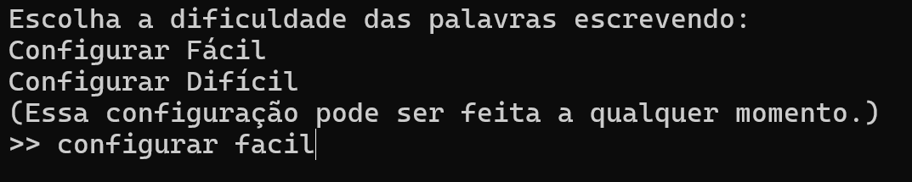
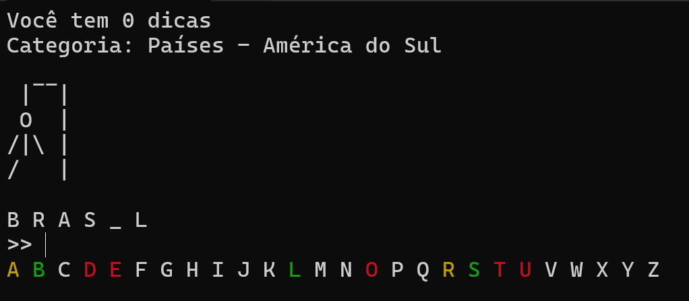

# Forcal

Um jogo de forca, mas que roda offline direto no terminal, utilizando Python.


## Como jogar

Ao iniciar você deve escolher entre `fácil` ou `difícil`, então uma palavra é sorteada automaticamente.<br>
<br><br>
No topo fica a contagem de dicas e a categoria da palavra.<br>
Escreva uma letra para fazer seu chute. Se já souber a palavra, pode digitar ela inteira de uma vez.<br>
A cada chute errado o personagem vai ganhando um membro, se ele ficar completo você perde o jogo, então uma nova palavra na mesma dificuldade será sorteada.<br>
A cada chute as letras do alfabeto ficam coloridas:

- **verde**: a letra está na palavra.
- **vermelho**: a letra não está na palavra.
- **amarelo**: a letra foi revelada por dica.

<br>


Você pode usar o comando `dica` para receber uma dica da palavra:

- A primeira e a segunda dica revelam uma letra aleatória da palavra.
- A terceira dica é uma informação sobre a palavra. Por exemplo, com a palavra secreta `BRASIL` a dica será `América do Sul`, e com `MONTANHA` a dica será `Forma de relevo`.
- Se faltar descobrir apenas uma letra, o `dica` mostra essa informação em vez de revelar a letra, a dica nunca irá ganhar o jogo sozinha.

Na linha de baixo fica o alfabeto para referência, onde você pode ver as letras já jogadas e suas respectivas cores, branca caso a letra não tenha sido testada ainda.

O jogo trata acentos, unifica 'Ç' e 'C', letras maiúsculas e minúsculas. Espaços, hífens, apóstrofos e números já aparecem na palavra e não precisam ser chutados.

<br>


### Comandos especiais

- `dica`: revela uma letra ou uma informação sobre a palavra.
- `sair` (ou `Ctrl+C`): encerra o jogo mostrando a palavra secreta.
- `configurar fácil` ou `configurar difícil`: muda a dificuldade no meio do jogo, mostrando a palavra atual e sorteando uma nova.

## Como rodar

### Windows (.exe)
Baixe o [forcal.exe na página de Releases](https://github.com/Odahvin/Forcal/releases/latest) e dê dois cliques. Não é preciso instalar mais nada.

### Com o Python (Windows, Mac e Linux)
1. Instale o Python
2. Baixe o projeto e extraia em qualquer pasta, certifique-se de deixar os arquivos 'forcal-facil.json', 'forcal-dificil.json' e 'forcal.py' na mesma pasta
3. Abra o terminal na pasta escolhida e execute: `python forcal.py`

### Notas

O `forcal-facil.json` possui cerca de mil palavras, `forcal-dificil.json` possui cerca de 400 palavras.
Se escolher a versão zip, você pode substituir os json por outro arquivo json com o mesmo nome ou adicionar as próprias palavras, categorias e informações, seguindo a mesma formatação dos arquivos originais.

```json
{
    "Países": {
        "BRASIL": "América do Sul",
        "JAPÃO": "Ásia"
    },
    "Frutas": {
        "MORANGO": "Vermelha"
    }
}
```

- Escreva as palavras em **MAIÚSCULAS** (com acento, se tiver).
- O texto depois dos dois pontos é a terceira dica.
- Toda categoria precisa ter pelo menos uma palavra.


### Licença

O código do Forcal é distribuído sob a licença MIT (veja o arquivo `LICENSE`).

Parte das palavras das listas `forcal-facil.json` e `forcal-dificil.json` veio de [random-words-api.kushcreates.com](https://random-words-api.kushcreates.com/); a lista foi filtrada e modificada com acréscimos e remoções manuais.